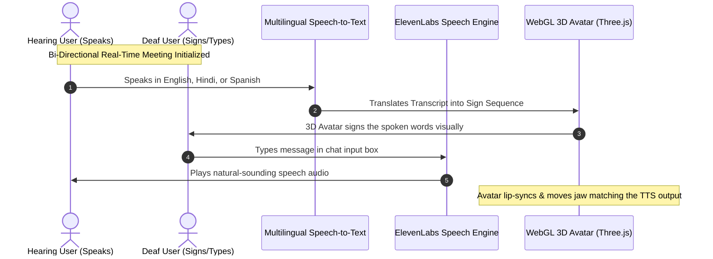

# Matri (Sanket AI) — Resume Entry & Interview Guide

This guide contains a professional, resume-ready project entry for your CV, followed by a comprehensive breakdown of the platform's **bi-directional flow**, **multilingual design**, and **detailed tech stack** to help you discuss it in interviews.

---

## Part 1: Professional Resume Entry
*Copy and paste the section below directly into your resume's **Projects** or **Experience** section.*

### **Matri (Sanket AI) — Bi-Directional Multilingual Sign Language & Telehealth Platform**
*Solo Developer | Next.js, WebGL (Three.js), WebRTC (LiveKit), Express.js, Firebase, ElevenLabs API*
* Developed a high-performance, accessible, and **bi-directional** virtual meeting platform enabling real-time communication between deaf/mute and hearing users through a synchronised, multilingual 3D avatar interpreter.
* Built a client-side **3D WebGL Avatar Engine** using **Three.js** and **React Three Fiber (R3F)** to render smooth sign language gestures and fingerspelling (A-Z) using spherical interpolation (`slerp`) for natural skeletal transitions.
* Engineered a **multilingual speech translation pipeline** using the browser's **Web Speech API** to capture and translate audio in multiple spoken languages (e.g., English, Hindi, Spanish) directly into universal sign language gestures.
* Integrated **LiveKit SFU (WebRTC)** for ultra-low latency, multi-party video/audio conferencing and high-speed data channels to synchronize real-time subtitles and translation vectors across all peers.
* Implemented a **bi-directional communications channel**: hearing users speak to generate real-time sign language, while deaf/mute users type messages that trigger natural-sounding voice synthesis via the **ElevenLabs TTS API** with dynamic lip-syncing (morph targets and jaw bone rotation).
* Optimized application performance with Next.js dynamic imports (`ssr: false`) and **Draco decompression loaders**, reducing 3D avatar bundle size and bringing initial load times under 1 second.
* Built a custom signaling Express.js server running **Socket.IO** for connection room orchestration, and integrated **Firebase Authentication** and **Cloud Firestore** for secure, database-backed user management and session logging.

**Technologies Used**: Next.js 15, React 19, TypeScript, Three.js, React Three Fiber (R3F), WebRTC (LiveKit SFU), Express.js, Socket.IO, Firebase Auth & Firestore, Web Speech API (Multilingual StT), ElevenLabs TTS API, Tailwind CSS, Framer Motion, Draco Loader.

---

## Part 2: Detailed Technology Stack Breakdown

* **Frontend Engine**: Built with React 19 and Next.js 15 (App Router), optimizing client-side performance, state management, and page transition animations (using Framer Motion).
* **3D Graphics & Animation Pipeline**:
  * **Three.js & React Three Fiber**: Renders the 3D model in the browser using WebGL.
  * **Draco Compression**: Compresses the GLTF 3D model geometry to minimize network bandwidth.
  * **Skeletal Animation System**: Direct bone manipulation of Mixamo-compliant rigs (shoulders, arms, elbows, forearms, wrists, and fingers) through quaternion math.
  * **Morph Target Influences**: Dynamically binds face meshes for realistic blinking, smiling, and lip-syncing.
* **Real-Time Communication (RTC)**:
  * **LiveKit SFU**: Handles routing of raw audio/video tracks. By using an SFU instead of traditional peer-to-peer WebRTC, the server scales efficiently and handles bandwidth fluctuations.
  * **LiveKit Data Channels**: Relays text packets containing transcription text and metadata tokens to ensure perfect alignment between voice audio and visual gestures.
  * **Socket.IO**: Connects clients to the Express server for signaling, room state synchronization, and peer coordination before handshaking with the LiveKit server.
* **AI & Speech API Pipeline**:
  * **Multilingual Web Speech Recognition**: Captures local microphone audio and uses language locale tags (e.g., `en-US`, `hi-IN`, `es-ES`) to transcribe speech in multiple languages.
  * **ElevenLabs TTS**: Converts text typed by deaf users into high-fidelity, multilingual spoken audio, supporting customizable voices, tones, and dialects.

---

## Part 3: End-to-End Bi-Directional Meeting Flow

The system supports a continuous **two-way loop**, allowing a natural conversation flow between a hearing participant and a deaf/mute participant:

### 1. Hearing-to-Deaf Channel (Speech-to-Sign)
* Hearing participant speaks into their microphone.
* The system's transcription engine captures the spoken language, identifies the language type, and transcribes the speech.
* The transcription text is converted into tokenized sign commands, which are pushed to the WebGL rendering queue.
* The 3D avatar executes the sign gestures dynamically on the deaf participant's screen.

### 2. Deaf-to-Hearing Channel (Text-to-Speech & Lip-Sync)
* The deaf participant responds by typing text into the chat interface.
* The text is sent to the **ElevenLabs TTS API**, generating a high-quality audio stream in the selected language.
* The audio is broadcasted to the hearing participant’s speakers.
* Simultaneously, the avatar on screen performs realistic lip-syncing animations (moving facial morph targets and the jaw bone) to match the spoken audio.

---

## Part 4: Future Roadmap (Active Enhancements)

* **Phase 1: Real-time Sign-to-Speech (Computer Vision)**: Integrating **Google MediaPipe Hands** or **TensorFlow.js** to track the deaf user's webcam feed. The hand landmark data will be analyzed by a machine learning model to translate physical hand signs back into spoken text in real-time.
* **Phase 2: Contextual Sign Language Grammar (NLP)**: Introducing an LLM-based translation layer (e.g. Gemini API) to translate standard spoken language structures into proper sign language grammar rules (such as ASL or ISL Gloss structures) before driving the 3D model's bones, preventing literal word-for-word translation.
* **Phase 3: Offline Dictionary Storage**: Caching the skeletal poses locally using browser **IndexedDB**, allowing the sign dictionary and fingerspelling functions to operate offline or during poor network conditions.
